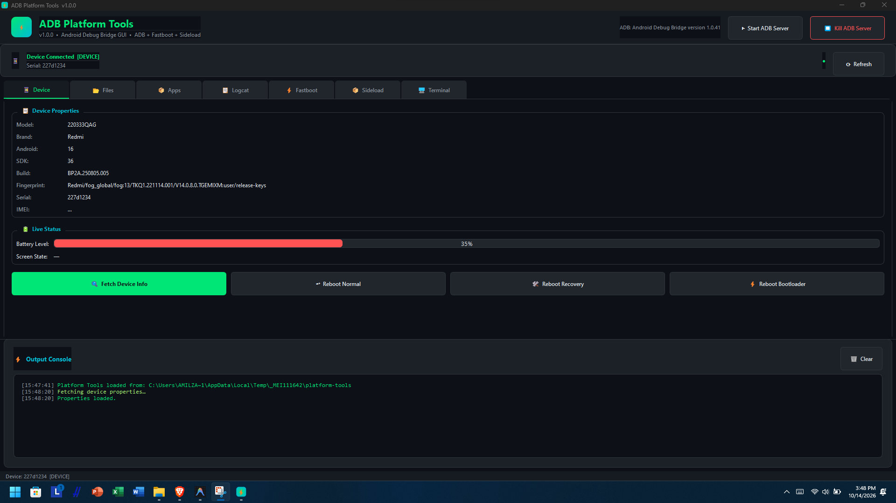
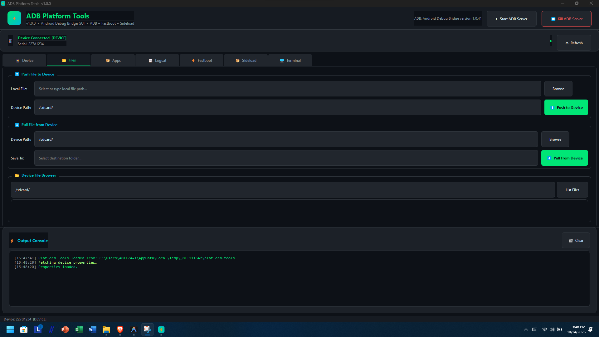
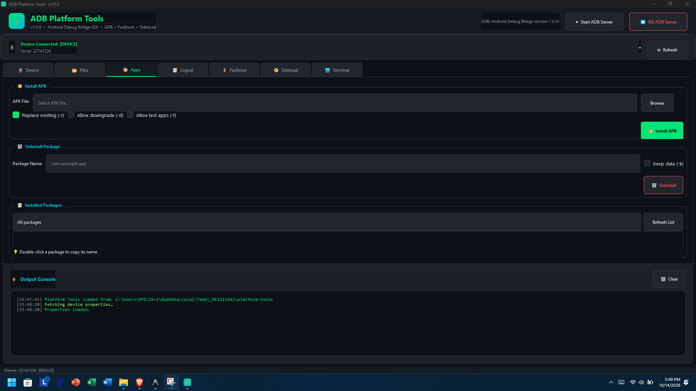
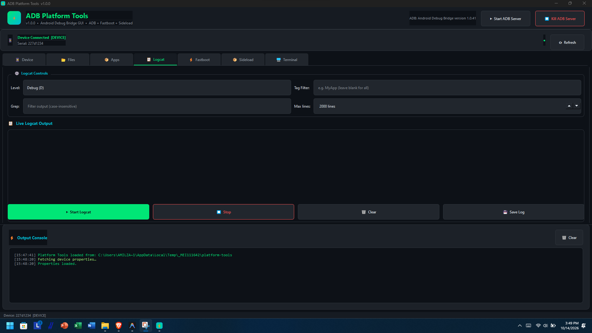
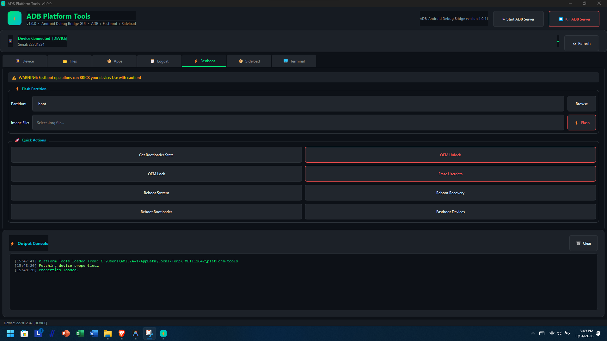
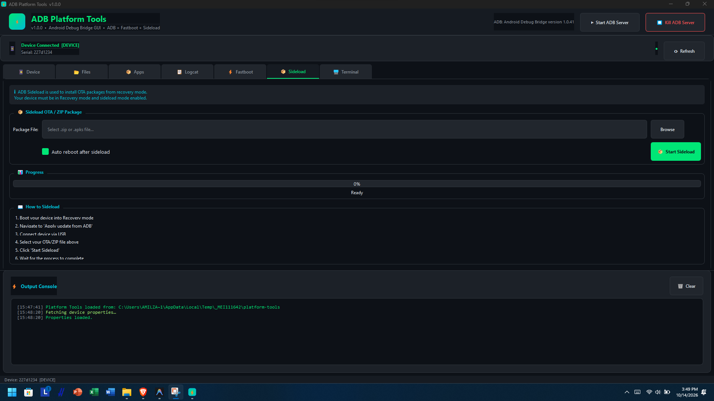
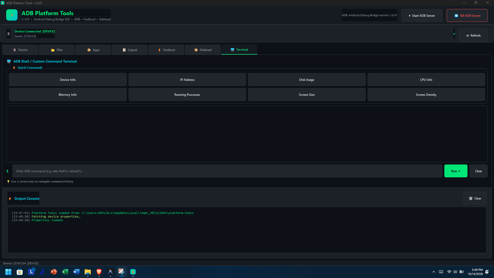

<div align="center">

# ⚡ ADB Platform Tools GUI

**A modern, feature-rich Windows GUI for Android Platform Tools**  
*ADB · Fastboot · Sideload — all in one beautiful dark-themed application*

[](https://python.org)
[](https://pypi.org/project/PyQt6/)
[](https://www.microsoft.com/windows)
[](LICENSE)

</div>

---

## 📋 Overview

**ADB Platform Tools GUI** is a sleek, dark-themed Windows desktop application that wraps Google's Android Platform Tools (ADB, Fastboot, Fastboot) into an intuitive graphical interface. No more memorizing command-line syntax — everything is just a click away.

> ✅ Designed for Android developers, power users, and ROM flashers.

---

## ✨ Features

| Tab | Features |
|-----|----------|
| 📱 **Device Info** | View device properties, battery level, screen state, reboot options |
| 📂 **File Manager** | Push/Pull files, browse device storage |
| 📦 **App Manager** | Install/Uninstall APKs, list installed packages with filtering |
| 📋 **Logcat** | Live logcat with level filters, tag filter, grep, color-coded output, save to file |
| ⚡ **Fastboot** | Flash partitions, OEM unlock/lock, erase userdata, quick actions |
| 📦 **Sideload** | ADB sideload OTA/ZIP packages with progress indicator |
| 🖥️ **Terminal** | Custom ADB shell commands with history and quick-command shortcuts |

### 🎨 Design Highlights
- 🌑 Dark theme with green/cyan accent colors
- 📊 Real-time output console with timestamps
- 🔄 Auto device detection (polls every 5 seconds)
- ⌨️ Command history navigation (↑↓ arrow keys)
- ✅ Confirmation dialogs for dangerous operations
- 📋 One-click package name copy

---

## 🖼️ Screenshots

<div align="center">

### 📱 1. Device Info & Controls


<br/>

### 📂 2. File Manager (Push, Pull & Storage Browser)


<br/>

### 📦 3. App & Package Manager


<br/>

### 📋 4. Live Color-Coded Logcat


<br/>

### ⚡ 5. Fastboot & Bootloader Operations


<br/>

### 📦 6. ADB Sideload (OTA / Recovery)


<br/>

### 🖥️ 7. Interactive Terminal & ADB Shell


</div>

---

## 📁 Project Structure

```
Platform Tools/
├── main.py              ← Main application source (PyQt6)
├── requirements.txt     ← Python dependencies
├── build.py             ← Build script (compiles to .exe)
├── README.md            ← Project documentation
├── docs/
│   └── screenshots/     ← Application preview screenshots
└── platform-tools/      ← Google Android Platform Tools
    ├── adb.exe
    ├── fastboot.exe
    ├── AdbWinApi.dll
    ├── AdbWinUsbApi.dll
    └── ...
```

---

## 🚀 Quick Start

### Option A: Run from Source

**Prerequisites:** Python 3.10+ installed on your system.

```bash
# 1. Clone the repository
git clone https://github.com/Firatzzz/platform_tools.git
cd platform_tools

# 2. Install dependencies
pip install -r requirements.txt

# 3. Run the application
python main.py
```

### Option B: Build .exe (Recommended for Distribution)

```bash
# Build standalone executable
python build.py
```

The compiled `.exe` will be in the `dist/` folder along with the `platform-tools/` directory.

> ⚠️ **Important:** Always distribute the `dist/` folder as a whole — the `.exe` needs the `platform-tools/` folder next to it.

---

## 🔧 Detailed Usage

### 📱 Device Tab
1. Connect your Android device via USB
2. Enable **USB Debugging** in Developer Options on your device
3. Click **⟳ Refresh** or wait for auto-detection
4. Click **🔍 Fetch Device Info** to load all properties

### 📂 File Manager Tab
- **Push:** Select a local file → set device destination path → Push
- **Pull:** Enter device file path → set save folder → Pull
- **Browse:** Enter a device directory → click List Files

### 📦 App Manager Tab
- **Install APK:** Browse `.apk` file → configure options → Install
- **Uninstall:** Enter package name (e.g. `com.example.app`) → Uninstall
- **Package List:** Use filter dropdown → Refresh List → double-click to copy package name

### 📋 Logcat Tab
1. Set log level (Verbose/Debug/Info/Warning/Error)
2. Optionally filter by tag or grep text
3. Click **▶ Start Logcat** → view color-coded live output
4. Click **💾 Save Log** to export

### ⚡ Fastboot Tab
> ⚠️ **Device must be in Fastboot/Bootloader mode**

- **Flash Partition:** Select partition name + `.img` file → Flash
- **OEM Unlock/Lock:** Unlocks bootloader (wipes data!)
- **Erase Userdata:** Full data wipe

### 📦 Sideload Tab
> ⚠️ **Device must be in Recovery mode with sideload enabled**

1. Boot device into Recovery → Apply update from ADB
2. Select your OTA `.zip` file
3. Click **📦 Start Sideload** and monitor progress

### 🖥️ Terminal Tab
- Type any `adb` or `fastboot` command directly
- Use **Quick Commands** buttons for common operations
- Navigate history with ↑↓ arrow keys

---

## 📦 Dependencies

| Package | Version | Purpose |
|---------|---------|---------|
| `PyQt6` | ≥ 6.6.0 | GUI framework |
| `PyInstaller` | ≥ 6.3.0 | Compile to .exe |

---

## 🛠️ Build from Source

### Requirements
- Python 3.10 or newer
- pip (Python package manager)
- Windows 10/11

### Build Steps

```bash
# Install build dependencies
pip install pyinstaller PyQt6

# Build one-file executable
python build.py

# Or manually with PyInstaller
pyinstaller --onefile --windowed --name ADB-Platform-Tools main.py
```

---

## ⚙️ Platform Tools Version

This application uses the **official Google Android Platform Tools**.  
Download the latest version from: https://developer.android.com/tools/releases/platform-tools

Place the extracted `platform-tools/` folder in the same directory as `main.py`.

---

## ⚠️ Warnings & Disclaimers

> [!WARNING]
> **Fastboot operations (flash, unlock, erase) can permanently brick your device.** Only use if you know what you're doing. Always back up your data before any Fastboot operation.

> [!CAUTION]
> **OEM Unlock will wipe ALL data on your device.** This is irreversible.

> [!NOTE]
> This tool requires **USB Debugging** to be enabled on your Android device for ADB operations.

---

## 🤝 Contributing

Contributions are welcome! Please:

1. Fork the repository
2. Create a feature branch (`git checkout -b feature/amazing-feature`)
3. Commit your changes (`git commit -m 'Add amazing feature'`)
4. Push to the branch (`git push origin feature/amazing-feature`)
5. Open a Pull Request

---

## 📄 License

This project is licensed under the **MIT License** — see the [LICENSE](LICENSE) file for details.

---

## 🙏 Acknowledgements

- [Google Android Platform Tools](https://developer.android.com/tools/releases/platform-tools) — ADB, Fastboot binaries
- [PyQt6](https://www.riverbankcomputing.com/software/pyqt/) — Python Qt bindings
- [PyInstaller](https://pyinstaller.org/) — Python to executable compiler

---

<div align="center">

Made with ❤️ for the Android community

⭐ **Star this repo if you find it useful!** ⭐

</div>
